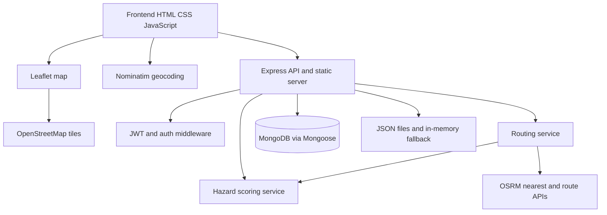

# Street Safety System

> An intelligent map-based platform for community-driven hazard reporting and safety-aware route planning.

## Introduction

Street Safety System is a web-based civic safety project designed to help people understand the conditions around them before choosing a route. It brings hazard reports, location data, community feedback, and route planning together on one interactive map focused on Mysuru.

Instead of looking only at distance, the system lets users compare three perspectives: the **fastest route**, the **safest route**, and an **optimal route** that balances travel distance with nearby hazard exposure. Users can explore reported hazards as guests, use their location or search for places, create authenticated reports, and help validate existing reports through voting.

This project was built as an academic and portfolio exploration of how full-stack web development, geospatial processing, graph algorithms, external mapping services, and community-driven data can work together in a practical safety-aware navigation experience. The current repository is a functional prototype with synthetic demonstration data, not an official emergency or public-safety service.

### Technology Badges

[](https://nodejs.org/)
[](https://expressjs.com/)
[](https://www.mongodb.com/)
[](https://developer.mozilla.org/en-US/docs/Web/JavaScript)
[](https://leafletjs.com/)
[](https://www.openstreetmap.org/)
[](https://project-osrm.org/)
[](https://jwt.io/)

## Contents

- [Introduction](#introduction)
- [Overview](#overview)
- [Quick Start](#quick-start)
- [Key Features](#key-features)
- [Screenshots and Visual Assets](#screenshots-and-visual-assets)
- [System Architecture](#system-architecture)
- [How It Works](#how-it-works)
- [Core Technical Implementation](#core-technical-implementation)
- [Algorithms and Data Structures](#algorithms--data-structures)
- [Tech Stack](#tech-stack)
- [API Reference](#api-reference)
- [Data Model](#data-model)
- [Getting Started](#getting-started)
- [Security Considerations](#security-considerations)
- [Limitations and Future Roadmap](#limitations)
- [Testing and Development Scripts](#testing)

## Overview

Street Safety System is a full-stack prototype for exploring how localized hazard information can influence everyday route planning. The browser application combines an interactive Leaflet map, community hazard reports, severity signals, voting, browser geolocation, and a Node.js/Express API that generates three route perspectives through Mysuru:

- **Fastest**: minimizes distance-based edge cost.
- **Safest**: minimizes hazard exposure.
- **Optimal**: balances distance and hazard cost.

This is more than a basic CRUD application. Its core technical surface includes geospatial coordinate processing, point-to-road-segment distance calculations, configurable hazard influence, OSRM road geometry, a graph built from candidate paths, a custom min-heap priority queue, Dijkstra route selection, JWT authentication, MongoDB persistence, and a JSON/in-memory fallback mode.

> **Data disclaimer:** The bundled Mysuru hazard records are synthetic demo data generated by `generate_mysuru_crimes.js`. They are not live crime, emergency, or official civic records. This project must not be used as a substitute for emergency services or local authority guidance.

## Project at a glance

| Area | Implemented capability |
| --- | --- |
| Map | Leaflet map centered on Mysuru with OpenStreetMap tiles |
| Hazards | Marker visualization, severity/category views, status, timestamps, radius, and votes |
| Reporting | Authenticated hazard submission with map picking and geocoding fallback |
| Community input | Per-user upvote/downvote behavior |
| Routing | OSRM-backed candidate paths evaluated as fastest, safest, and optimal |
| Authentication | Registration, login, seven-day JWTs, secure cookie, and Bearer-token middleware |
| Storage | MongoDB when connected; JSON-backed users and in-memory hazard behavior otherwise |

## Quick Start

Run the project locally from the repository root:

```powershell
npm install
npm start
```

Then open [http://localhost:3000/](http://localhost:3000/) to view the landing page, or [http://localhost:3000/map.html](http://localhost:3000/map.html) to open the interactive map. MongoDB is optional for exploration; the application has a local fallback mode when MongoDB is unavailable.

For complete prerequisites, environment configuration, database behavior, and demo data instructions, see [Getting Started](#getting-started), [MongoDB Setup](#mongodb-setup), and [Demo Data](#demo-data).

## Problem Statement

Traditional route selection is usually framed around getting from point A to point B efficiently. Street Safety System explores a broader design objective: how can localized, community-reported hazards be represented spatially and incorporated into route evaluation without removing the user's ability to compare trade-offs?

The project focuses on the gap between a hazard report on a map and a route decision. A report needs a location, severity, influence area, and community signal; a route needs road geometry and segment-level costs. This system connects those two representations into one inspectable workflow.

## Solution

The application follows this flow:

```text
User selects or searches a source and destination
        |
        v
Frontend resolves coordinates using map picking, GPS, or Nominatim
        |
        v
Express validates coordinates and loads available hazards
        |
        v
OSRM snaps endpoints and supplies real-road candidate polylines
        |
        v
The routing service builds a graph and scores its road segments
        |
        v
Dijkstra evaluates fastest, safest, and balanced route costs
        |
        v
Frontend renders route lines, segment colors, distance, hazard score, and safety tier
```

The result is not a single opaque recommendation. It is a comparison surface that exposes distance, hazard score, and safety tier for three different route strategies.

## Key Features

### Interactive Safety Map

- Leaflet map centered on Mysuru.
- OpenStreetMap tile layer with attribution.
- Hazard markers rendered in two modes: severity signal or hazard category.
- Popups showing hazard type, severity, status, date, radius, and verification count.
- Source and destination selection by typed address, map pin, or coordinates.
- Browser geolocation with a current-location marker and proximity radar.
- Nearest-hazard calculation using a Haversine distance function.
- Route overlays with segment-specific safety colors and hide/show controls.

### Hazard Reporting

- Authentication required before a report can be submitted.
- Hazard categories such as accidents, potholes, lighting, construction, flooding, unsafe crossings, and general hazards.
- Severity input constrained in the UI to a 1-10 range and clamped by the API.
- Map-based location selection with a draggable report pin.
- Optional address/landmark and incident details.
- Nominatim lookup when a text location needs to be converted into coordinates.
- New reports receive initial vote and verification values in the implemented submission flow.

### Community Interaction

- Authenticated users can upvote or downvote a hazard.
- A user's vote can switch from upvote to downvote and vice versa.
- Repeat votes are detected for the same direction.
- Vote counts are used in hazard confidence calculations where the hazard data includes them.

### Safety-Aware Routing

- OSRM `/nearest` snaps endpoints and detour waypoints to nearby roads.
- OSRM `/route` supplies full GeoJSON polylines and alternative driving routes.
- Candidate paths are combined into a graph of street nodes and bidirectional edges.
- Every edge receives distance and hazard-score values.
- Dijkstra runs with three cost functions: distance-only, hazard-heavy, and weighted distance-plus-hazard.
- The response contains fastest, safest, and optimal route objects with coordinates, distance, hazard score, safety level, colors, and evaluated segments.

### Authentication

- Registration accepts `username`, `email`, and `password`.
- Login accepts `email` and `password`.
- Passwords are hashed with `bcryptjs` before persistence.
- JWTs contain the user's email and expire after seven days.
- The server accepts the JWT from an HTTP-only cookie or `Authorization: Bearer <token>`.
- Protected operations include session lookup, hazard submission, upvotes, and downvotes.

### Data Persistence

- Mongoose connects to MongoDB when available.
- Static demo hazards are loaded from `backend/data/crimes.json`.
- MongoDB and static hazards are normalized and combined for public hazard reads.
- Fallback users are read from and written to `backend/data/users.json`.
- Fallback hazard submissions and votes are held in memory and are lost when the process restarts.

## Screenshots and Visual Assets

The repository does not contain captured application screenshots in PNG, JPG, or GIF form. It does contain four SVG assets in `frontend/images/`, which are linked below as the project's available visual resources:

| Asset | Repository file |
| --- | --- |
| Visual asset 1 | [frontend/images/1.svg](frontend/images/1.svg) |
| Visual asset 2 | [frontend/images/2.svg](frontend/images/2.svg) |
| Visual asset 3 | [frontend/images/3.svg](frontend/images/3.svg) |
| Placeholder asset | [frontend/images/placeholder.svg](frontend/images/placeholder.svg) |

The implemented screens themselves are `landing.html`, `map.html`, `login.html`, and `register.html`. Add browser screenshots to the repository later if a visual case study is required.

## System Architecture



### Components

- **Frontend**: Static HTML, CSS, and browser JavaScript in `frontend/`; `map-script.js` owns map state, markers, geolocation, reporting, voting, and route rendering.
- **Express server**: `backend/server.js` serves the frontend, configures CORS/cookies/JSON parsing, exposes REST endpoints, and chooses MongoDB or fallback behavior.
- **Authentication**: `jsonwebtoken`, `bcryptjs`, cookies, local storage, and Bearer headers work together for the current browser flow.
- **Hazard scoring**: `backend/services/hazard-scoring.js` calculates segment impact and route-level safety metadata.
- **Routing**: `backend/services/routing.js` consumes OSRM geometry, builds the candidate graph, and runs Dijkstra.
- **MongoDB layer**: `backend/crime.js` and `backend/user.js` define the Mongoose models.
- **Fallback layer**: static `crimes.json`, file-backed `users.json`, and process-memory hazard state allow local exploration when MongoDB is unavailable.

## How It Works

### Route Planning Flow

1. The user enters an origin and destination, uses browser GPS for the origin, or picks points on the map.
2. If a field is text-only, the frontend calls Nominatim and converts the first result into latitude/longitude.
3. The frontend sends `source` and `destination` to `POST /api/routes`.
4. The server validates the coordinate values and loads available hazards.
5. OSRM snaps the endpoints to nearby roads and returns direct driving routes plus sampled detour routes.
6. Candidate OSRM polylines become graph nodes and bidirectional edges.
7. Each edge is scored using distance from hazards to the road segment, hazard weight, influence radius, proximity decay, and vote multiplier.
8. Dijkstra runs with the fastest, safest, and optimal cost functions.
9. Each selected path is evaluated again to produce total distance, total hazard score, safety level, colored segments, and route metadata.
10. The frontend draws all available route segments and presents comparison cards.

### Hazard Reporting Flow

1. A user registers or signs in.
2. The frontend obtains a report location from a map pin, typed coordinates, Nominatim, or the map center fallback.
3. The authenticated client posts the hazard type, location, details, coordinates, address, and severity to `POST /api/crimes`.
4. The API applies a default or clamped severity, creates the report, and stores it in MongoDB when connected.
5. If MongoDB is unavailable, the report is added to the in-memory hazard collection for the running process.
6. Public hazard reads combine available database records with the static/fallback hazard collection.
7. Authenticated users can vote on the report, changing its vote signal in MongoDB or in memory.
8. Vote values contribute to the scoring engine when the route engine evaluates the hazard.

## Core Technical Implementation

### Hazard Scoring Engine

`backend/services/hazard-scoring.js` and `backend/config/hazard-config.js` separate scoring logic from configuration.

For each road segment, the engine:

1. Computes segment length with the Haversine formula.
2. Computes the point-to-segment distance from each hazard using a local equirectangular-style projection.
3. Looks up a hazard-type weight and influence radius.
4. Ignores hazards outside their configured radius.
5. Applies linear proximity decay:

   ```text
   proximityFactor = 1 - (distanceMeters / radiusMeters)
   ```

6. Applies a vote confidence multiplier:

   ```text
   voteMultiplier = max(0.5, 1 + 0.1 * (upvotes - downvotes))
   ```

7. Adds the hazard impact to the segment total:

   ```text
   hazardImpact = hazardWeight * proximityFactor * voteMultiplier
   ```

The engine then evaluates every segment in a path and returns total distance, total hazard score, a normalized hazard density, safety-level metadata, and colored segments.

Configured safety levels are `Very Safe`, `Safe`, `Moderate`, `Unsafe`, and `Dangerous`. Their thresholds are defined in `SAFETY_LEVELS`, rather than being hard-coded in the frontend.

### Route Generation

The project intentionally combines external road data with custom optimization logic:

1. **External road routing/data**: OSRM supplies nearest-road snapping and driving-route polylines based on OpenStreetMap road data.
2. **Custom hazard scoring**: the project evaluates the OSRM road segments against local hazard records.
3. **Custom route optimization**: the project constructs a graph from candidate polylines and selects paths with Dijkstra.

The configured balanced formula is:

```text
cost = (1.0 * distanceKm) + (0.005 * hazardScore)
```

In practical terms, the optimal strategy adds a configurable penalty for hazard exposure while keeping distance in the same edge-cost calculation. The implementation also uses these strategy-specific costs:

| Strategy | Edge cost used by Dijkstra |
| --- | --- |
| Fastest | `distanceKm` |
| Safest | `(hazardScore * 1000) + distanceKm` |
| Optimal | `(ALPHA * distanceKm) + (BETA * hazardScore)` |

When the initial optimal path collapses to the fastest or safest path while distinct alternatives exist, the implementation tests several beta values and looks for an intermediate trade-off path.

### Geospatial Processing

- Coordinates are represented as latitude/longitude pairs.
- Haversine distance is used for point-to-point proximity and route-node comparisons.
- Point-to-segment distance estimates how close a hazard is to a road edge.
- Hazard radius determines whether a hazard influences an edge.
- Leaflet handles map display, markers, polylines, and map picking.
- Browser geolocation supplies the user's current position when permission is granted.
- Nominatim converts text queries into coordinates.
- OSRM converts arbitrary points into road-aware route geometry.

## Algorithms & Data Structures

### Haversine distance

- **Where**: `backend/services/hazard-scoring.js` and the frontend proximity radar.
- **Input**: Two latitude/longitude points.
- **Purpose**: Estimate geographic distance on the Earth's surface.
- **Output**: Distance in kilometers.

### Point-to-segment distance

- **Where**: `calculateSegmentHazardScore`.
- **Input**: A hazard point and the two endpoints of a road segment.
- **Purpose**: Determine whether a hazard affects that particular road edge.
- **Output**: Distance in meters, used with the configured influence radius.

### Graph construction

- **Where**: `buildGraphFromPaths` in `backend/services/routing.js`.
- **Structure**: A node array plus adjacency lists.
- **Input**: Candidate OSRM coordinate paths.
- **Purpose**: Deduplicate nearby coordinates and represent candidate street segments as bidirectional edges.
- **Output**: Graph nodes and edges carrying distance and hazard-score values.

### Min-heap priority queue

- **Where**: `PriorityQueue` in `backend/services/routing.js`.
- **Structure**: Array-backed binary min-heap with bubble-up and sink-down operations.
- **Purpose**: Select the next lowest-cost graph node during Dijkstra.
- **Output**: The node with the smallest queued priority.

### Dijkstra's algorithm

- **Where**: `runDijkstra` in `backend/services/routing.js`.
- **Input**: The candidate graph, start node, end node, and a strategy-specific cost function.
- **Purpose**: Find a minimum-cost path over the generated graph.
- **Output**: An ordered coordinate path reconstructed through a parent array.

### Sorting and deduplication

- **Where**: `combineCrimes` and the frontend proximity logic.
- **Purpose**: Remove duplicate hazard IDs, sort public hazards by upvotes, and rank nearby hazards by distance.
- **Output**: Ordered hazard collections for API responses and map display.

## Tech Stack

### Frontend

| Technology | Role |
| --- | --- |
| HTML, CSS, JavaScript | Static application pages and browser interaction |
| Leaflet 1.9.4 | Interactive map, markers, polylines, and map controls |
| Browser Geolocation API | Current-location marker and proximity radar |

### Backend

| Technology | Role |
| --- | --- |
| Node.js | JavaScript runtime and built-in `fetch`/`AbortController` usage |
| Express 4 | REST API and static frontend server |
| `body-parser` | JSON request parsing |
| `cors` | CORS configuration with credentials and authorization headers |
| `cookie-parser` | Reading and clearing authentication cookies |

### Database and Models

| Technology | Role |
| --- | --- |
| MongoDB | Optional persistent storage for users and `Crime` documents |
| Mongoose | Connection management, schemas, model access, and password hooks |
| JSON files and memory | Fallback users and hazards when MongoDB is unavailable |

### Authentication and Security Libraries

| Technology | Role |
| --- | --- |
| `jsonwebtoken` | Seven-day JWT creation and verification |
| `bcryptjs` | Password hashing and comparison |

### Mapping, Geocoding, and Routing

| Technology | Role |
| --- | --- |
| OpenStreetMap | Map tile and road-data source used through public services |
| Nominatim | Browser address-to-coordinate lookup |
| OSRM | Nearest-road snapping and driving route geometry |

## Key Engineering Decisions

- **Leaflet keeps map behavior in the browser**: the frontend can render marker modes, map picks, route segments, and geolocation without a frontend framework or build step.
- **OSRM supplies road-aware geometry**: the project does not invent roads; it evaluates real candidate polylines returned by an external routing service.
- **Scoring is separated from routing**: hazard calculations are reusable for individual segments and complete paths, while routing owns graph construction and strategy selection.
- **Configuration is separated in `hazard-config.js`**: risk weights, influence radii, route constants, and safety thresholds can be inspected and changed independently of the scoring algorithm.
- **Dijkstra is parameterized by a cost function**: the same graph search implementation supports the fastest, safest, and balanced route perspectives.
- **MongoDB has a fallback path**: the application remains explorable without a local database, while the README clearly distinguishes what is and is not persisted in fallback mode.
- **JWTs support both cookie and Bearer transport**: this matches the current server middleware and frontend local-storage flow.

## API Reference

All endpoints are implemented in `backend/server.js`.

### Public endpoints

| Method | Endpoint | Authentication | Description |
| --- | --- | --- | --- |
| `GET` | `/` | No | Serves `frontend/landing.html`. |
| `GET` | `/index.html` | No | Serves the landing page. |
| `GET` | `/landing` | No | Serves the landing page. |
| `GET` | `/api/crimes` | No | Returns combined hazards sorted by descending upvotes. |
| `GET` | `/api/hazard-config` | No | Returns hazard weights, radii, routing constants, and safety levels. |
| `POST` | `/api/register` | No | Registers a user, sets a cookie, and returns a JWT/user summary. |
| `POST` | `/api/login` | No | Authenticates a user, sets a cookie, and returns a JWT/user summary. |
| `POST` | `/api/logout` | No | Clears the `token` cookie. |
| `POST` | `/api/routes` | No | Generates fastest, safest, and optimal route results. |

### Authenticated endpoints

| Method | Endpoint | Authentication | Description |
| --- | --- | --- | --- |
| `GET` | `/api/me` | JWT cookie or Bearer token | Returns the current user's email. |
| `POST` | `/api/crimes` | JWT cookie or Bearer token | Submits a hazard report. |
| `POST` | `/api/crimes/:id/upvote` | JWT cookie or Bearer token | Adds or switches the user's upvote. |
| `POST` | `/api/crimes/:id/downvote` | JWT cookie or Bearer token | Adds or switches the user's downvote. |

### Authentication header

```http
Authorization: Bearer <jwt>
```

The frontend also stores the returned token in `localStorage` and sends it as a Bearer token. The server sets an HTTP-only `token` cookie as well.

The login page currently displays these development demo credentials:

| Account | Email | Password |
| --- | --- | --- |
| Citizen | `citizen@mysuru.gov` | `password123` |
| Officer | `officer@mysuru.gov` | `secure_password123` |

These are development credentials only and must not be reused in a deployed environment.

### Registration request and response

```http
POST /api/register
Content-Type: application/json
```

```json
{
  "username": "Mysuru_Citizen",
  "email": "citizen@example.com",
  "password": "example-password"
}
```

Successful registration returns status `201` with the implemented shape:

```json
{
  "message": "User registered successfully",
  "token": "<jwt>",
  "user": {
    "email": "citizen@example.com",
    "username": "Mysuru_Citizen"
  }
}
```

### Hazard report request and response

```http
POST /api/crimes
Authorization: Bearer <jwt>
Content-Type: application/json
```

```json
{
  "type": "Pothole",
  "hazardType": "Pothole",
  "location": "12.3052, 76.6552",
  "details": "Large surface defect near the junction",
  "latitude": 12.3052,
  "longitude": 76.6552,
  "address": "Near Mysuru Palace",
  "severity": 6
}
```

The successful response has status `201` and the shape `{ "message": "...", "crime": { ... } }`. The stored crime fields differ slightly between the MongoDB document and the fallback object; see [Data Model](#data-model).

### Route request and response

```http
POST /api/routes
Content-Type: application/json
```

```json
{
  "source": { "lat": 12.2958, "lon": 76.6394 },
  "destination": { "lat": 12.3052, "lon": 76.6552 }
}
```

The API accepts `lat`/`lon`, `latitude`/`longitude`, and destination longitude aliases `lng`/`longitude`. Successful responses include:

```json
{
  "fastestRoute": {
    "name": "Fastest Route",
    "type": "fastest",
    "coordinates": [[12.29, 76.63]],
    "distanceKm": 0,
    "hazardScore": 0,
    "safetyLevel": "Very Safe",
    "color": "#007bff",
    "safetyColor": "#1a73e8",
    "segments": []
  },
  "safestRoute": {},
  "optimalRoute": {},
  "constants": { "alpha": 1, "beta": 0.005 },
  "source": { "lat": 12.2958, "lon": 76.6394 },
  "destination": { "lat": 12.3052, "lon": 76.6552 }
}
```

The abbreviated empty objects in this example indicate the repeated route-object shape; actual successful responses populate all three route objects. Each segment contains `start`, `end`, `distanceKm`, `hazardScore`, `safetyLevel`, and `color`.

## Data Model

### MongoDB `Crime` model

Defined in `backend/crime.js` and stored in the explicit `crime` collection:

| Field | Type / behavior |
| --- | --- |
| `type` | Required string |
| `location` | Required string |
| `latitude` / `longitude` | Required numbers |
| `severity` | Required number from 1 to 10 |
| `address` | Required string |
| `details` | Optional string |
| `upvotes` / `downvotes` | Number counters |
| `upvotedBy` / `downvotedBy` | Arrays of user emails |
| `createdAt` | Date with `Date.now` default |

### MongoDB `User` model

Defined in `backend/user.js`:

| Field | Type / behavior |
| --- | --- |
| `username` | Required and unique string |
| `email` | Required and unique string |
| `password` | Required string; hashed by a Mongoose pre-save hook |
| `createdAt` | Date with `Date.now` default |

### Static/generated hazard record

`backend/data/crimes.json` and `frontend/data/crimes.json` contain generated demo records such as:

```json
{
  "id": "MYS-HAZ-0001",
  "hazardType": "Fallen Tree",
  "description": "[Simulated Demo] ...",
  "latitude": 12.302984,
  "longitude": 76.655541,
  "severity": 6,
  "timestamp": "2026-02-07T09:07:59.443Z",
  "verificationCount": 21,
  "status": "pending",
  "hazardRadius": 82
}
```

The server normalizes these records into its in-memory representation with fields including `id`, `_id`, `type`, `hazardType`, `description`, coordinates, severity, vote arrays, status, timestamp, and radius. `status`, `timestamp`, `verificationCount`, and `hazardRadius` are present in the generated demo shape but are not fields in the Mongoose `Crime` schema.

## Project Structure

```text
.
├── backend/
│   ├── config/
│   │   └── hazard-config.js       Weights, radii, route constants, safety levels
│   ├── data/
│   │   ├── crimes.json            Generated static hazard records
│   │   └── users.json             Fallback user persistence
│   ├── services/
│   │   ├── hazard-scoring.js      Distance, influence, scoring, path evaluation
│   │   └── routing.js              OSRM integration, graph, heap, Dijkstra, routes
│   ├── crime.js                    Mongoose Crime model
│   ├── extractor.js                Empty placeholder module
│   ├── package.json                Backend package metadata
│   ├── server.js                   Express API and static-file server
│   └── user.js                     Mongoose User model and password hooks
├── frontend/
│   ├── data/crimes.json            Generated frontend copy of demo hazards
│   ├── images/                     SVG visual assets
│   ├── landing.html                Overview and hazard-feed page
│   ├── landing-style.css           Landing/auth styling
│   ├── login.html                  Login and demo-login page
│   ├── map.html                    Interactive map and route controls
│   ├── map-script.js               Map, geolocation, reporting, voting, routing
│   ├── map-style.css                Map and control styling
│   └── register.html                Registration page
├── .env.example                    Example environment values
├── generate_mysuru_crimes.js       Synthetic Mysuru hazard generator
├── metadata.json                   Project metadata
├── package.json                    Root scripts and runtime dependencies
└── package-lock.json                Root dependency lockfile
```

## Getting Started

### Prerequisites

- Node.js 18 or newer.
- npm.
- A modern browser.
- Internet access for OpenStreetMap tiles, Nominatim, and OSRM.
- MongoDB is optional for local exploration, but recommended when persistent database behavior is required.

Node.js 18+ is the practical minimum because the routing service uses the global `fetch` and `AbortController` APIs.

### Installation

Run the root installation from the repository directory:

```powershell
npm install
```

Use the root package rather than installing only inside `backend/`: the root package includes runtime dependencies used by `server.js`, including `cookie-parser` and `jsonwebtoken`, which are not listed in the separate backend package manifest.

### Run locally

```powershell
npm start
```

Open [http://localhost:3000/](http://localhost:3000/) after the server starts.

The development command currently starts the same server process:

```powershell
npm run dev
```

It does not invoke `nodemon`, despite `nodemon` being present as a development dependency.

### Environment Variables

The repository includes `.env.example`:

```env
PORT=3000
MONGODB_URI=mongodb://localhost:27017/streetSafetyDB
JWT_SECRET=streetsafety_jwt_secret_dev_key_2026
```

Current implementation details matter:

- `MONGODB_URI` is read from `process.env`, with a fallback to `mongodb://127.0.0.1:27017/streetSafetyDB`.
- `JWT_SECRET` is read from `process.env`, with a development fallback secret in source code.
- `PORT` is documented in `.env.example` but is not currently read; the server always listens on port `3000`.
- The `dotenv` dependency is installed but `dotenv.config()` is not called, so a `.env` file is not automatically loaded.

For a local PowerShell session, provide the values explicitly:

```powershell
$env:MONGODB_URI = "mongodb://127.0.0.1:27017/streetSafetyDB"
$env:JWT_SECRET = "replace-with-a-long-development-secret"
npm start
```

## MongoDB Setup

The server attempts a Mongoose connection using:

```text
mongodb://127.0.0.1:27017/streetSafetyDB
```

or the `MONGODB_URI` process variable. Startup uses a two-second server-selection timeout. If the connection fails, the application continues in fallback mode instead of stopping.

| Data | MongoDB connected | MongoDB unavailable |
| --- | --- | --- |
| Static hazards | Loaded and combined with database hazards | Loaded from `backend/data/crimes.json` |
| New hazard reports | Persisted as `Crime` documents | Stored in process memory only |
| User registration | Persisted as `User` documents | Written to `backend/data/users.json` |
| Votes | Persisted on the `Crime` document | Mutated in process memory only |
| Restart behavior | Database records remain | Fallback reports and votes are lost; fallback users remain in JSON |

## Demo Data

Regenerate the synthetic dataset with:

```powershell
node generate_mysuru_crimes.js
```

The generator writes 1,000 records to both:

- `backend/data/crimes.json`
- `frontend/data/crimes.json`

Records are distributed around configured Mysuru localities, vary severity and radius, and include statuses such as `verified`, `pending`, and `expired`. Descriptions are prefixed with `[Simulated Demo]` to make their status explicit.

The running API reads the backend copy. The frontend copy is included as project data but is not the primary dataset used by the Express server.

## Security Considerations

### Implemented

- JWT creation with a seven-day expiration.
- JWT verification middleware for protected endpoints.
- Password hashing and comparison with `bcryptjs`.
- HTTP-only authentication cookie configuration.
- Bearer-token authentication support.
- Protected hazard submission and voting endpoints.
- CORS configuration that allows credentials and the `Authorization` header.

### Production Security Improvements

The current configuration is suitable for a prototype, not a hardened public deployment. Production work should include:

- load secrets through a secret manager and rotate JWT secrets;
- remove the source-code fallback JWT secret;
- deploy exclusively over HTTPS and review `Secure`/`SameSite` cookie behavior;
- add input validation, request-size limits, rate limiting, and abuse prevention;
- add moderation and audit logging for community reports and votes;
- avoid automatic account creation during unknown-credential fallback login;
- minimize and protect stored location/account data;
- add monitoring and alerting around authentication and external-service failures.

## Limitations

### Current Prototype Limitations

- Bundled hazard records are synthetic and geographically centered on Mysuru.
- The API returns pending and expired static records; it does not filter them out of `/api/crimes`.
- MongoDB and static hazards are combined, so duplicate governance is handled by ID deduplication rather than a single authoritative source.
- Fallback hazard submissions and votes are not persisted across restarts.
- In fallback mode, an unknown login email is automatically registered for convenience.
- The documented `PORT` value is currently ignored, and `.env` loading is not initialized.
- The authentication cookie uses `SameSite=None` and `Secure=true`, which is awkward for plain HTTP local development; the frontend also sends a Bearer token.
- The routing engine evaluates a candidate set of direct and sampled-detour OSRM paths, not every possible road-network path.
- Routing, geocoding, map tiles, and browser geolocation depend on external services or user permissions.
- There is no automated test suite, moderation dashboard, role system, report deletion endpoint, or rate limiting.
- `metadata.json` mentions a Gemini capability, but no Gemini integration is implemented in the inspected source.

### Production Requirements

Before using this as a public safety service, it would require verified data governance, moderation workflows, privacy controls, robust input validation, abuse prevention, managed external-service access, observability, reliable persistence, secure deployment, and independent safety evaluation.

## Future Roadmap

- [ ] Connect verified and governed hazard data sources.
- [ ] Build an administration and moderation dashboard.
- [ ] Add report lifecycle controls, audit history, and deletion workflows.
- [ ] Add automated unit, integration, and end-to-end tests.
- [ ] Add rate limiting, validation, abuse prevention, and request monitoring.
- [ ] Replace fallback login convenience behavior with strict authentication semantics.
- [ ] Add production-grade secret management, HTTPS deployment, and JWT rotation.
- [ ] Add caching and provider controls for OSRM and Nominatim requests.
- [ ] Expand route generation and evaluate a broader road network.
- [ ] Add privacy-aware retention and location-data controls.
- [ ] Make environment loading and port configuration explicit and reliable.

## Testing

No automated test suite is currently included in the repository. The current `build` and `lint` scripts are placeholder commands that print status messages; they do not compile, lint, or test the application.

For manual verification:

1. Start the server with `npm start`.
2. Open the landing page and map at `http://localhost:3000/` and `http://localhost:3000/map.html`.
3. Check public hazard loading and map marker rendering.
4. Register or use the displayed development demo account.
5. Verify authenticated report submission and voting.
6. Supply source and destination points and verify the three route cards when OSRM is reachable.

## Development Scripts

| Command | Description |
| --- | --- |
| `npm install` | Installs root dependencies. |
| `npm start` | Runs `node backend/server.js`. |
| `npm run dev` | Runs `node backend/server.js`; no file watcher is configured. |
| `npm run build` | Prints `No build step required`; no build is performed. |
| `npm run lint` | Prints `No lint errors`; no lint tool is run. |
| `node generate_mysuru_crimes.js` | Regenerates 1,000 synthetic Mysuru hazard records in both data folders. |

## Contributing

1. Keep changes focused and preserve the existing frontend/backend boundary.
2. Mark synthetic or generated data clearly.
3. Document any new endpoint, field, environment variable, or external service.
4. Test the affected browser flow and API behavior manually until automated tests exist.
5. Do not present prototype behavior as verified public-safety data or production security.

## License

No license file is currently included in this repository. Add an explicit license before distributing the project publicly.

---

Built as an academic and portfolio exploration of geospatial visualization, community hazard reporting, and safety-aware route optimization.
